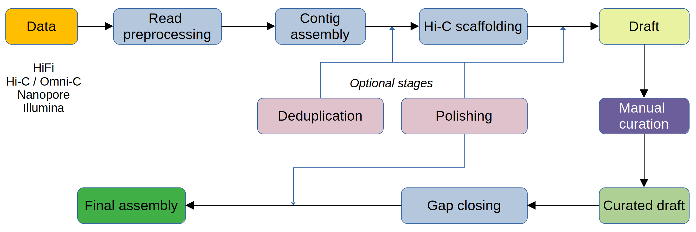
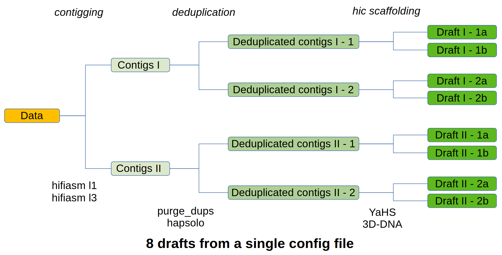

<p align="center">
  <h1 align="center">AssemblyBrute - Pipeline to "brute force" and evaluate de novo genome assemblies</h1>
</p>

<p align="center">
  <i>Generation of multiple assemblies using different tools and different parameters from a single config file</i>
</p>

Core of AssemblyBrute is based on principles of VGP-pipeline and Rapid curation but with additional stages and multiple additions for QC, evaluation and curation.


Features of AssemblyBrute:

 - designed to bruteforce assembly process
 - flexible with optional stages
 - integrates multiple coretools for each stage
 - contains various option presets for each coretools
 - fine tunable QC at each stage
 - can process polyploid genomes

<p align="center">
    <br>
<em><b>Figure 1</b>: Overview of the AssemblyBrute pipeline </em>
</p>

<p align="center">
    <br>
<em><b>Figure 2</b>: Main pricnciple of the AsssemblyBrute: one config - multiple assemblies </em>
</p>


# Documentation

Start with the [documentation index](docs/README.md) and the
[test-data examples](docs/examples/README.md). The guide covers:

- [Installation](docs/installation.md) and [input preparation](docs/inputs.md).
- [Configuration](docs/configuration.md), [stage ordering](docs/stages.md), and
  [local/Slurm execution](docs/running.md).
- [Outputs](docs/outputs.md), [focused recipes](docs/recipes.md),
  and [troubleshooting](docs/troubleshooting.md).

# Run an example

If you wish to run it using Conda via Snakemake, then you will need:

- Conda or Mamba.
- Snakemake v7 (tested using 7.32.4).
- FCS database and FCS_GX Singularity container (optional).
- FCS_adapter Singularity container (optional).
- Kraken databases (optional).
- RapidCuration Singularity containers (this dependency will be excluded soon).

Complete [installation](docs/installation.md), prepare your inputs, and save a
project configuration as `config/data/local.yaml`. The
[example catalog](docs/examples/README.md) provides complete configurations and
dataset-specific commands. Inspect your job graph from the repository root:

```bash
snakemake --configfile config/data/local.yaml \
  --cores 8 --use-conda --conda-frontend conda --dry-run --printshellcmds
```

Set separate input/output directories for each dataset. Selected stages may
require additional environments, databases, containers, or scheduler settings.

# Workflow support

Validation varies by tool, stage, and configuration. Consult the
[support matrix](docs/stages.md#tool-support) before
selecting tools or stages, and the [example catalog](docs/examples/README.md)
for dataset-specific commands and validation status.

Pipeline-specific errors and workarounds are described in
[troubleshooting](docs/troubleshooting.md).

Historical R Markdown manuals and assets are preserved under
[docs/old/](docs/old/); use the current Markdown guide for setup and execution.

